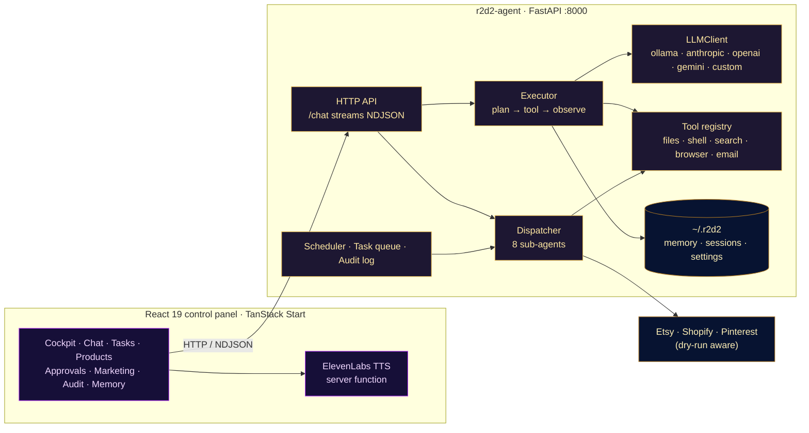

<p align="center">
  
</p>

<p align="center">
  
</p>

<p align="center">
  <a href="https://github.com/kamikaze1120/r2d2-ai-agent/commits/main"></a>
  
  
  
</p>

**R2D2** is a two-piece, local-first AI agent: a **Python/FastAPI agent core** that plans, calls tools, dispatches sub-agents and keeps memory on your machine, plus a **React 19 control panel** where you chat with it, watch its task queue, approve its actions and hear it talk back. Out of the box it is pointed at running a digital-product business (research → product → listing → upload → marketing), with dry-run mode and an approval gate in front of external writes.

<p align="center"><sub><code>LOCAL-FIRST</code> ✦ <code>MULTI-LLM</code> ✦ <code>SUB-AGENTS</code> ✦ <code>TOOL CALLING</code> ✦ <code>VOICE</code> ✦ <code>HUMAN APPROVALS</code></sub></p>

<h2 align="center">✦ WHAT IT DOES ✦</h2>
<p align="center"><sub>CAPABILITIES VERIFIED AGAINST THE CODE</sub></p>

<table>
  <tr>
    <td width="33%" valign="top">🔀 <b>Any LLM</b><br><sub>One client for Ollama, Anthropic, OpenAI, Gemini and any OpenAI-compatible URL (Groq, Together, LM Studio). Switch it live via <code>PATCH /llm-config</code> or Settings.</sub></td>
    <td width="33%" valign="top">🧩 <b>8 sub-agents</b><br><sub>Research, product, listing, upload, marketing, strategy, browser and email. Any <code>.py</code> in <code>r2d2/agents/</code> with an async <code>run(task)</code> is auto-registered.</sub></td>
    <td width="33%" valign="top">🛠️ <b>22 tools</b><br><sub>Workspace file ops, shell, DuckDuckGo search, memory, math, 7 Playwright browser tools and 3 SMTP/IMAP email tools.</sub></td>
  </tr>
  <tr>
    <td valign="top">📈 <b>Capability tiers</b><br><sub>Provider + model name map to <code>basic</code> / <code>standard</code> / <code>advanced</code>, reported on <code>/health</code>.</sub></td>
    <td valign="top">🤖 <b>Autonomous mode</b><br><sub>The scheduler seeds a daily business run, a daily analytics sync and a weekly strategy review; a strategy review also fires every 5 published products.</sub></td>
    <td valign="top">🛡️ <b>Approvals &amp; dry run</b><br><sub>Listings below <code>R2D2_APPROVAL_THRESHOLD</code> wait in the Approvals queue. <code>R2D2_DRY_RUN</code> turns Etsy, Shopify and Pinterest writes into previews.</sub></td>
  </tr>
  <tr>
    <td valign="top">🎙️ <b>Voice in, voice out</b><br><sub>ElevenLabs TTS through a server function (your own key or an env key) and a Web Speech listener with a “Hey R2D2” wake phrase.</sub></td>
    <td valign="top">🌐 <b>Three.js orb</b><br><sub>The cockpit's wireframe orb pulses with the live TTS amplitude.</sub></td>
    <td valign="top">📜 <b>Audit trail</b><br><sub>Platform calls, safety changes and host actions are written to an audit log you can browse in the panel.</sub></td>
  </tr>
</table>

<h2 align="center">◈ ARCHITECTURE ◈</h2>
<p align="center"><sub>BROWSER COCKPIT ⇄ LOCAL AGENT CORE</sub></p>



<details>
<summary><b>Autonomous workflow chain</b> (hard-coded in <code>agents/dispatcher.py</code>, no LLM in the control loop)</summary>

```
research_niches
  → create_product (top 3 niches)
      → create_listing
          → upload_product   (held for approval if confidence < threshold)
              → generate_marketing
                  [every 5 products] → strategy_review
```

</details>

<h2 align="center">◆ TECH STACK ◆</h2>
<p align="center"><sub>WHAT ACTUALLY SHIPS IN THIS REPO</sub></p>

<p align="center">
  
</p>

| Layer | What's used |
|---|---|
| Agent core | Python 3.10+, FastAPI, Uvicorn, httpx, Pydantic, python-dotenv, filelock |
| LLM SDKs | `anthropic`, `openai`, `google-generativeai`; Ollama over HTTP |
| Tools | `duckduckgo-search`, Playwright (Chromium), ReportLab + Pillow for generated PDFs |
| Control panel | React 19, TanStack Start / Router / Query, Tailwind CSS 4, Radix UI, Recharts, Three.js |
| Panel runtime | Vite 7 with a Cloudflare Workers target (`wrangler.jsonc`) |

<h2 align="center">✦ QUICK START ✦</h2>
<p align="center"><sub>TWO TERMINALS · ABOUT FIVE MINUTES</sub></p>

**Prerequisites:** Python 3.10+, Node.js, and either [Ollama](https://ollama.com/download) or an API key for Claude / OpenAI / Gemini / an OpenAI-compatible host.

```bash
git clone https://github.com/kamikaze1120/r2d2-ai-agent.git
cd r2d2-ai-agent
```

**1 · Boot the agent core**

```bash
cd r2d2-agent
./run.sh          # Windows PowerShell: .\run.ps1
```

The script copies `.env.example` → `.env` on first run, creates `.venv/`, installs `requirements.txt`, installs Playwright Chromium, then starts the API on **http://localhost:8000**.

```bash
curl http://localhost:8000/health
```

**2 · Boot the control panel** (from the repo root)

```bash
npm install
npm run dev
```

Open the URL Vite prints → **Settings** → confirm the API base URL is `http://localhost:8000`, pick a provider and model, then give R2D2 a command from the **Cockpit** or **Chat**.

<details>
<summary><b>Pick an LLM provider</b> (<code>r2d2-agent/.env</code>)</summary>

| Provider | Set |
|---|---|
| Ollama (default) | `R2D2_LLM_PROVIDER=ollama`, `OLLAMA_HOST`, `R2D2_MODEL` (e.g. `llama3.2`, `mistral`, `qwen2.5`) |
| Anthropic | `R2D2_LLM_PROVIDER=anthropic`, `ANTHROPIC_API_KEY`, `R2D2_MODEL` |
| OpenAI | `R2D2_LLM_PROVIDER=openai`, `OPENAI_API_KEY`, `R2D2_MODEL` (optional `OPENAI_BASE_URL`) |
| Gemini | `R2D2_LLM_PROVIDER=gemini`, `GEMINI_API_KEY`, `R2D2_MODEL` |
| OpenAI-compatible | `R2D2_LLM_PROVIDER=custom`, `CUSTOM_LLM_BASE_URL`, `CUSTOM_LLM_API_KEY`, `R2D2_MODEL` |

**Capability tier** (`config.get_capability_tier()`): Anthropic → `advanced`; OpenAI → `advanced` unless the model name contains `mini`/`3.5`; Gemini → `advanced` unless it is a `flash` model; Ollama and custom models are tiered by size hints in the name (`7b`/`8b`/`13b`… → `standard`, `70b`/`72b` → `advanced`, otherwise `basic`).

</details>

<details>
<summary><b>All environment variables</b> (names only — see <code>r2d2-agent/.env.example</code>)</summary>

| Group | Variables |
|---|---|
| Server | `R2D2_HOST`, `R2D2_PORT`, `R2D2_ALLOWED_ORIGINS` |
| LLM | `R2D2_LLM_PROVIDER`, `R2D2_MODEL`, `OLLAMA_HOST`, `ANTHROPIC_API_KEY`, `OPENAI_API_KEY`, `OPENAI_BASE_URL`, `GEMINI_API_KEY`, `CUSTOM_LLM_BASE_URL`, `CUSTOM_LLM_API_KEY` |
| Agent | `R2D2_MAX_ITERATIONS` (default 12), `R2D2_GOAL`, `R2D2_DAILY_RUN_SECONDS` |
| Safety | `R2D2_SHELL_ALLOWLIST`, `R2D2_APPROVAL_THRESHOLD` (default 0.8), `R2D2_DRY_RUN`, `R2D2_ACTION_ALLOWLIST`, `R2D2_FS_RESTRICT`, `R2D2_FS_EXTRA_ROOT` |
| Voice | `ELEVENLABS_API_KEY` (or paste your own key in Settings → Voice) |
| Email | `EMAIL_ADDRESS`, `EMAIL_PASSWORD`, `EMAIL_SMTP_HOST`, `EMAIL_SMTP_PORT`, `EMAIL_IMAP_HOST` |
| Etsy | `ETSY_API_KEY`, `ETSY_OAUTH_TOKEN`, `ETSY_REFRESH_TOKEN`, `ETSY_SHOP_ID` |
| Shopify | `SHOPIFY_STORE`, `SHOPIFY_ADMIN_TOKEN` |
| Pinterest | `PINTEREST_ACCESS_TOKEN`, `PINTEREST_BOARD_ID` |
| Storage | `R2D2_DATA_DIR` (default `~/.r2d2`), `R2D2_WORKSPACE` (default `~/.r2d2/workspace`) |

Missing platform credentials simply disable that platform — R2D2 still boots.

</details>

<h2 align="center">◈ SUB-AGENTS &amp; TOOLS ◈</h2>
<p align="center"><sub>DROP IN A FILE · RESTART · IT'S LIVE</sub></p>

| Sub-agent | Owns |
|---|---|
| 🔭 `research_agent` | Niche scouting and keyword discovery |
| 🎨 `product_agent` | Generates real files — planner / ebook PDFs via ReportLab |
| 📝 `listing_agent` | SEO titles, descriptions and tags |
| 🚀 `upload_agent` | Publishes to Etsy / Shopify behind the confidence gate |
| 📣 `marketing_agent` | Pinterest pin copy — posts when configured, otherwise queues |
| 🧭 `strategy_agent` | Performance review and pivot suggestions |
| 🌐 `browser_agent` | Playwright navigation, clicks, form fill, scraping |
| 📧 `email_agent` | Read, search and send mail over IMAP / SMTP |

<details>
<summary><b>Registered tools</b> (<code>r2d2/tools.py</code>)</summary>

| Tool | Description |
|---|---|
| `read_file` · `write_file` · `append_file` · `delete_file` · `list_dir` | File ops confined to the workspace (paths that escape it are refused) |
| `shell` | Runs in the workspace with a 60 s timeout; restrict with `R2D2_SHELL_ALLOWLIST` |
| `web_search` | DuckDuckGo search, no key needed |
| `remember` · `recall` | Long-term memory in file-locked JSON |
| `datetime` · `calculate` | Clock and math |
| `browser_navigate` · `browser_read` · `browser_click` · `browser_fill` · `browser_screenshot` · `browser_search` · `browser_js` | Playwright Chromium (registered when Playwright is installed) |
| `email_send` · `email_read` · `email_search` | SMTP / IMAP |
| `final_answer` | Ends the loop with the reply |

</details>

<details>
<summary><b>Add your own sub-agent</b></summary>

```python
# r2d2-agent/r2d2/agents/my_agent.py
from r2d2.agents._llm import llm_text

TASK_TYPES = ["my_custom_task"]   # optional: route these task types here

async def run(task: dict) -> dict:
    result = await llm_text(f"Do the thing: {task['payload'].get('input', '')}")
    return {"ok": True, "output": result}
```

Restart the core — the dispatcher logs `Loaded sub-agent: my_agent`.

</details>

<details>
<summary><b>HTTP API</b> (<code>r2d2/server.py</code>, <code>r2d2/api/host_routes.py</code>)</summary>

| Area | Routes |
|---|---|
| Status | `GET /health`, `GET /models`, `GET /tools`, `GET` / `PATCH /llm-config` |
| Chat | `POST /chat` (NDJSON stream), `GET` / `POST /sessions`, `GET` / `DELETE /sessions/{sid}` |
| Memory | `GET` / `POST /memories`, `DELETE /memories/{mid}` |
| Tasks | `GET` / `POST /tasks`, `GET` / `DELETE /tasks/{tid}`, `POST /tasks/{tid}/approve`, `POST /tasks/{tid}/reject` |
| Business | `GET /niches`, `GET /products`, `GET /products/{pid}/file`, `PATCH /products/{pid}/listing`, `GET /analytics/overview` |
| Marketing | `GET /marketing/queue/{kind}`, `POST /marketing/queue/{kind}/{item_id}/posted` |
| Automation | `GET /automation`, `POST /automation/start` · `stop` · `trigger/{job_name}`, `PATCH /automation/jobs/{job_name}`, `PATCH /automation/safety` |
| Audit | `GET /audit` |
| Host | `GET /host/fs/roots`, `POST /host/fs/list` · `read` · `write`, `POST /host/launch` |

</details>

<h2 align="center">◆ SAFETY ◆</h2>
<p align="center"><sub>IT CAN TOUCH YOUR MACHINE — SO KEEP THE GUARDRAILS ON</sub></p>

- File tools refuse paths outside `R2D2_WORKSPACE`; `/host/fs/*` is limited to the workspace (plus `R2D2_FS_EXTRA_ROOT`) while `R2D2_FS_RESTRICT=1`, the default.
- `shell` starts in the workspace but is a real shell — set `R2D2_SHELL_ALLOWLIST` (e.g. `ls,cat,git`) to limit which commands it may run.
- `R2D2_DRY_RUN=true` returns previews instead of writing to Etsy, Shopify or Pinterest; `R2D2_ACTION_ALLOWLIST` limits which task types the dispatcher will run.
- The shipped `.env.example` binds to `127.0.0.1` — keep it that way unless you deliberately want LAN access. See [`SECURITY.md`](SECURITY.md): do not expose the agent to the public internet.

<details>
<summary><b>Reaching your local agent from another device</b></summary>

The panel talks to whatever API base URL you give it. A tunnel works:

```bash
cloudflared tunnel --url http://localhost:8000
# or
ngrok http 8000
```

Paste the public URL into **Settings → API base URL**. Anyone with that URL can drive the agent, so only do this deliberately and close the tunnel afterwards.

</details>

<h2 align="center">✦ PROJECT MAP ✦</h2>
<p align="center"><sub>WHERE THINGS LIVE</sub></p>

<details>
<summary><b>Folder tree</b></summary>

```text
r2d2-ai-agent/
├─ r2d2-agent/                 Python agent core
│  ├─ run.sh · run.ps1         one-command boot
│  ├─ requirements.txt · .env.example
│  └─ r2d2/
│     ├─ server.py             FastAPI app
│     ├─ executor.py           plan → tool → observe loop
│     ├─ llm.py                multi-provider LLM client
│     ├─ config.py             env config + capability tiers
│     ├─ tools.py              tool registry
│     ├─ memory.py · memory/   sessions, long-term + business memory
│     ├─ agents/               dispatcher + 8 sub-agents
│     ├─ tools_pkg/            browser, email, Etsy, Shopify, Pinterest, PDF generator
│     ├─ core/                 task manager, scheduler, audit log
│     ├─ analytics/            performance tracker
│     └─ api/host_routes.py    host filesystem + app launch
├─ src/                        React control panel
│  ├─ routes/                  cockpit, chat, tasks, products, analytics, approvals,
│  │                           marketing, audit, tools, memory, settings
│  ├─ components/              views, Three.js orb, voice bubble, status widgets
│  ├─ hooks/                   TTS, voice commands, health polling
│  ├─ lib/                     API client, settings, browser memory, File System Access helpers
│  └─ server/tts.ts            ElevenLabs server function
└─ SECURITY.md
```

</details>

> R2-D2 is a trademark of its respective owner. This project is a fan-inspired homage and is not affiliated with Lucasfilm.

<p align="center">
  
  <br>
  <sub><code>◉ R2D2 // GILDED ORBIT</code> · built by <a href="https://github.com/kamikaze1120">kamikaze1120</a></sub>
</p>
